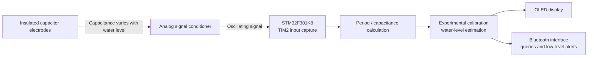

# Capacitive Water-Level Monitoring System

**A prototype for measuring water level using capacitive sensing, analog signal conditioning, and an STM32 microcontroller.**

## Overview

This academic project, carried out at **Mines Saint-Étienne (ISMIN)**, explores a non-mechanical method for monitoring the level of water in a container. Two insulated electrodes form a capacitor whose capacitance changes as the water level rises or falls. An analog conditioning circuit converts the small capacitance variation into a measurable oscillating signal. An **STM32F301K8** measures its period, estimates the water level using experimental calibration, and provides local display and Bluetooth communication.

The documented prototype integrates:

- **Capacitive sensing:** two electrically insulated electrodes immersed in water.
- **Analog electronics:** a constant-current-based conditioning circuit and hysteresis comparator, producing an oscillating signal.
- **Embedded acquisition:** STM32 timer input capture to measure the signal period.
- **Calibration:** an experimentally determined relationship between capacitance and water height.
- **User interface:** an OLED screen and Bluetooth commands/low-level alerts.

The full project report is available in **[docs/Rapport_Projet.pdf](docs/Rapport_Projet.pdf)** (in French).

## System architecture



### Operating principle

1. **Water-level change:** as the immersed portion of the electrodes changes, the dielectric distribution between the electrodes changes, and so does capacitance.
2. **Capacitance-to-period conversion:** the conditioning circuit uses a current source and a hysteresis comparator to generate an oscillating signal related to the sensor capacitance.
3. **Digital acquisition:** TIM2 on the STM32 is configured in **Input Capture** mode. The interval between two captured rising edges is used to determine signal period.
4. **Level estimation:** an experimental calibration curve converts the measured signal into an estimated water height.
5. **Output:** the estimated level is displayed on the OLED; Bluetooth supports commands and an automatic alert when the level falls below a configured threshold.

## Hardware and tools

| Area | Hardware / software | Role in the project |
| --- | --- | --- |
| Sensor | Two insulated electrodes | Capacitive detection of immersion height |
| Analog electronics | Constant-current conversion and hysteresis comparator | Capacitance-dependent oscillator |
| Embedded system | **STM32F301K8**, **STM32CubeIDE** | Timer capture, signal processing and peripheral control |
| Electronics design | **KiCad** | KiCad schematics and PCB layout design |
| Multiphysics simulation | **COMSOL Multiphysics** | Electrostatic modeling of capacitance versus water height |
| Measurements | **WaveForms** | Observation of conditioning-circuit signals |
| User interface | **OLED** and **Bluetooth** module | Local measurement display, remote requests and alerts |
| Mechanical design | **Autodesk Inventor**, 3D printing | Electrode support / mechanical prototyping |

## Repository Structure

```text
capacitive-water-level-sensor/
│
├── docs/
│   └── Rapport_Projet.pdf      # Complete technical report
│
├── firmware/
│   └── stm32/                  # STM32CubeIDE project and C source code
│
├── hardware/
│   └── kicad/                  # KiCad schematics and PCB design
│
├── simulation/
│   └── comsol/                 # COMSOL models
│
├── mechanical/
│   └── electrode_support.ipt   # Autodesk Inventor 3D CAD model
│
└── README.md                   # Project documentation
```

## Project team

- **Mohamed Yassir IGOUZOULENE**
- **Imane MOUMOUN**

## Documentation

- **[Full project report (PDF, French)](docs/Rapport_Projet.pdf)**
